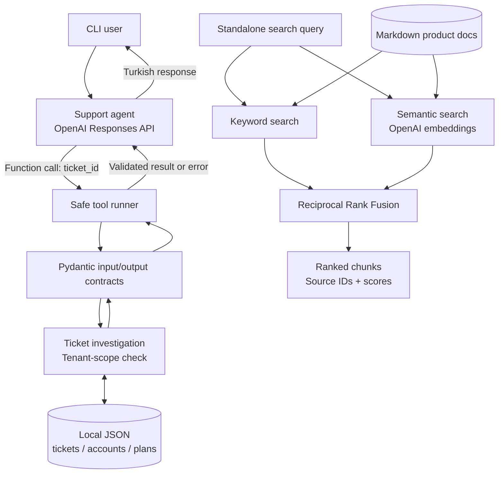

# TaskFlow — AI-Powered Technical Support Assistant

A **Python-based technical support agent prototype** for a fictional SaaS project-management platform. TaskFlow investigates support tickets using authorized account information, validates tool inputs and outputs, and generates concise Turkish-language responses through the **OpenAI Responses API**.

The project also includes a **standalone document retrieval pipeline** with keyword, semantic, and hybrid search. The retrieval pipeline is implemented and evaluated separately; **it is not yet connected to the support agent**.

> **Project status:** In active development · Local, synthetic data · 34 unit tests · Not production-ready

## What problem does it solve?

A customer reports:

> “Projeme yeni bir kullanıcı davet etmek istiyorum ama davet butonu pasif görünüyor.”  
> *“I want to invite a new team member, but the invitation button is disabled.”*

The current agent can retrieve ticket **TCK-001**, inspect the associated workspace and subscription plan, and establish that **Acme Workspace has 5 of 5 allowed members**. It distinguishes this verified account fact from a confirmed diagnosis or resolution. The product documentation explains invitation and member-limit rules, but **the agent does not yet search those documents automatically**.

## Implemented features

| Area | Current implementation |
| --- | --- |
| Ticket investigation | Reads tickets, workspaces, and subscription plans from local JSON files; calculates member-limit status. |
| Tenant-level access control | Rejects attempts to investigate a ticket belonging to a different tenant; account lookup uses the supplied trusted session scope. |
| Data contracts | Strict Pydantic v2 request, investigation-result, and tool-response validation; forbids unexpected fields and inconsistent success/error payloads. |
| Safe tool execution | Normalizes invalid input, access denial, missing resources, malformed output, data-access errors, and unexpected failures. |
| Single-turn AI agent | Uses the OpenAI Responses API to call `investigate_support_ticket` and summarize verified findings. |
| Multi-turn CLI agent | Conversational context via `previous_response_id`, automatic tool selection, `/yeni` and `/cikis` commands, and a limit of 3 tool calls per user turn. |
| Knowledge base | Fictional product documentation in Markdown, split into section-based chunks with stable source IDs; heading-only chunks are filtered out. |
| Keyword retrieval | Case-insensitive word-overlap matching and deterministic ranking. |
| Semantic retrieval | OpenAI `text-embedding-3-small` embeddings and cosine similarity, including Turkish queries against English documentation. |
| Hybrid retrieval | Combines keyword and semantic rankings with Reciprocal Rank Fusion (RRF, `k=60`). |
| Retrieval evaluation | Two manually labeled query scenarios measured with **Recall@3** for keyword and semantic search. |
| Automated tests | **34 unit tests** covering access control, contracts, tool-runner errors, chunk filtering, and RRF behavior. |

## Architecture

The support agent and document retrieval pipeline are currently **separate**:



**Security boundary:** the model's tool schema accepts `ticket_id` only. Tenant scope is supplied by Python application code, not by model-generated arguments. In this demo, `SESSION_TENANT_ID = "tenant-001"` is **hard-coded** in `src/agent.py`; it is not a real authenticated session.

## Tech stack

- **Python 3.10+** (Windows / PowerShell workflow)
- **OpenAI Python SDK** — Responses API for tool calling; embeddings API for semantic search
- **Pydantic v2** — strict data validation and cross-field rules
- **python-dotenv** — loading local API configuration
- **Python standard library** — `json`, `pathlib`, `unittest`, `unittest.mock`, `math`, and `re`
- **JSON and Markdown** — synthetic data and product documentation

No agent orchestration framework or vector database is required in the current version.

## Project structure

```text
TaskFlow/
├── data/
│   ├── accounts.json           # Synthetic workspace/account and user-role records
│   ├── plans.json              # Free and Pro plan limits
│   └── tickets.json            # Sample support ticket (TCK-001)
├── docs/
│   ├── invitations.md          # Invitation permissions and troubleshooting
│   └── plans.md                # Subscription and member-limit rules
├── src/
│   ├── read_ticket.py          # Read a ticket by ID
│   ├── inspect_account.py      # Retrieve workspace and subscription information
│   ├── investigate_ticket.py   # Join data and enforce tenant-level access checks
│   ├── tool_contract.py        # Pydantic input and investigation-result schemas
│   ├── tool_runner.py          # Safe execution and normalized tool responses
│   ├── agent.py                # Single-turn Responses API tool-calling demo
│   ├── chat_agent.py           # Multi-turn interactive CLI
│   ├── keyword_search.py       # Markdown chunking and keyword retrieval
│   ├── semantic_search.py      # Embeddings and cosine similarity
│   ├── hybrid_search.py        # RRF ranking fusion
│   └── evaluate_retrieval.py   # Keyword vs. semantic Recall@3 evaluation
├── tests/
│   ├── test_investigation.py
│   ├── test_tool_contract.py
│   ├── test_tool_runner.py
│   ├── test_chunking.py
│   └── test_hybrid_search.py
└── .gitignore
```

> Local `.env`, `.venv/`, and Python cache files are excluded from version control by `.gitignore` and should **not** be committed.

## Getting started (Windows / PowerShell)

### 1. Create a virtual environment

From the cloned or downloaded project directory:

```powershell
cd TaskFlow
python -m venv .venv
.\.venv\Scripts\Activate.ps1
```

If PowerShell blocks activation, for the current terminal session run:

```powershell
Set-ExecutionPolicy -Scope Process -ExecutionPolicy RemoteSigned
.\.venv\Scripts\Activate.ps1
```

### 2. Install dependencies

```powershell
python -m pip install "pydantic>=2,<3" openai python-dotenv
```

A pinned `requirements.txt` has **not yet been added** to this project.

### 3. Configure the API (for AI and embedding demos)

Create a `.env` file at the **project root**:

```dotenv
OPENAI_API_KEY=your_openai_api_key_here
OPENAI_MODEL=gpt-4.1-mini
```

The account and tool-runner examples, keyword search, RRF unit tests, and the unit test suite do not send OpenAI API requests. **Note:** `semantic_search.py` initializes an OpenAI client when imported, so the current test suite may still require `OPENAI_API_KEY` to be configured even though the tests themselves make no network calls. The agent, semantic search, hybrid search demo, and retrieval evaluation **do** make API requests and may incur usage charges.

**Never commit your real API key.**

## Run the demos

### Local investigation and validation (no API required)

```powershell
python src/read_ticket.py
python src/inspect_account.py
python src/investigate_ticket.py
python src/tool_contract.py
python src/tool_runner.py
```

An authorized investigation returns the workspace, plan, member count, and member-limit status. A cross-tenant request returns:

```text
success: False
error: ACCESS_DENIED
```

The tool runner additionally demonstrates `INVALID_INPUT` for a wrong `ticket_id` type or an unexpected `tenant_id` field.

### Single-turn AI agent

```powershell
python src/agent.py
```

The model calls `investigate_support_ticket`, Python executes the validated investigation, and the model receives the result. This script also prints input/output token usage when available.

### Interactive multi-turn AI agent

```powershell
python src/chat_agent.py
```

Example interaction (wording varies by model run):

```text
You: Merhaba, bir destek talebimi incelemek istiyorum.
Agent: Destek talebi ID'sini paylaşır mısınız?

You: TCK-001
[TOOL CALL] investigate_support_ticket
[TOOL RESULT] {'success': True, 'data': {...}}
Agent: Acme Workspace için Free planının 5/5 üye limitine ulaşıldı.
       Talep hâlâ açık; sorunun çözüldüğü doğrulanmadı.

You: /yeni
New conversation started.

You: TCK-999 numaralı ticket'ı incele.
[TOOL RESULT] {'success': False, 'error': 'TICKET_NOT_FOUND'}
```

`/yeni` starts a new conversation context; `/cikis` exits the CLI.

### Document retrieval demos

```powershell
python src/keyword_search.py
python src/semantic_search.py
python src/hybrid_search.py
python src/evaluate_retrieval.py
```

The retrieval demos use source identifiers such as `invitations:2` and `plans:3`. Hybrid search exposes each source's RRF score and the ranks contributed by the keyword/semantic methods.

## Tests

Run the complete suite without model API calls:

```powershell
python -m unittest discover -s tests -p "test_*.py" -v
```

**Latest observed project run: 34 tests passed.** Test breakdown:

| Test module | Tests |
| --- | ---: |
| `test_investigation.py` | 4 |
| `test_tool_contract.py` | 14 |
| `test_tool_runner.py` | 12 |
| `test_chunking.py` | 2 |
| `test_hybrid_search.py` | 2 |
| **Total** | **34** |

These tests verify targeted behaviors; they are not a measure of overall model answer accuracy or production security.

## Retrieval observations

After filtering out heading-only document chunks, the current knowledge base contains **6 chunks**. The two manually labeled evaluation queries produced:

| Query | Keyword Recall@3 | Semantic Recall@3 |
| --- | ---: | ---: |
| Turkish invitation issue | 0.00 | 1.00 |
| English member-limit issue | 1.00 | 1.00 |

This is a **small, illustrative evaluation**, not a statistically meaningful benchmark. The standalone hybrid search demo also runs successfully, but the repository's `evaluate_retrieval.py` **does not yet measure hybrid Recall@3 or Precision@3**. That is the next planned evaluation change.

## Known limitations

- **No real authentication or customer platform integration.** Tenant scope is hard-coded for the demo; production session management and authorization are not implemented.
- **No RAG-backed agent answers yet.** The current agent uses account/ticket data only. Keyword, semantic, and hybrid search are separate CLI modules.
- **Role-based invitation permissions are documented but not enforced in the investigation pipeline.** The account fixture contains sample user roles, but the current tool does not verify the acting user's invitation permission.
- **No customer messaging, billing, permission changes, or ticket updates.** The agent is read-only and must not mark a ticket as resolved from a suggested action alone.
- **No production-grade retrieval infrastructure.** Document embeddings are recomputed per query; there is no vector store, persistent embedding cache, or retrieval confidence calibration.
- **No complete agent evaluation or production observability.** Unit tests focus on Python behavior; semantic answer faithfulness, prompt-injection resistance, and end-to-end quality still need dedicated tests.

## Roadmap

- [ ] Expand retrieval evaluation with **Precision@3** and comparison of keyword, semantic, and hybrid search.
- [ ] Expose documentation search through a validated, source-aware agent tool.
- [ ] Generate structured, cited internal findings and customer-facing response drafts.
- [ ] Handle missing information, uncertain evidence, and human-support escalation explicitly.
- [ ] Add robust user/role authorization and more adversarial cross-tenant tests.
- [ ] Introduce a product-specialist agent and compare single-agent vs. multi-agent behavior.
- [ ] Add approval-gated local ticket updates, regression evaluations, and repeatable demos.
- [ ] Add dependency pinning, `.env.example`, and deployment-oriented operational guidance.

## Purpose

This project is a hands-on **AI Agent / Automation Engineering portfolio project** focused on separating deterministic business logic from LLM reasoning, maintaining clear trust boundaries, building testable tools, and evaluating retrieval rather than assuming generated answers are correct.

**TaskFlow is fictional. All account, workspace, and ticket data are synthetic.**
